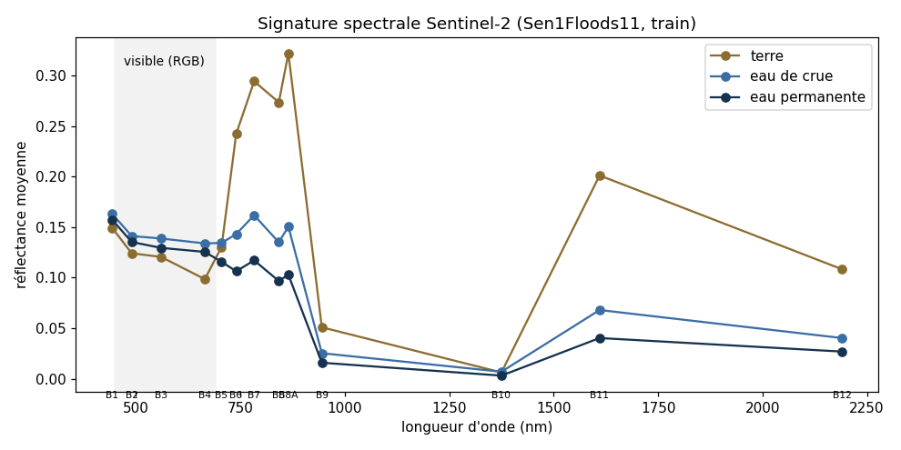
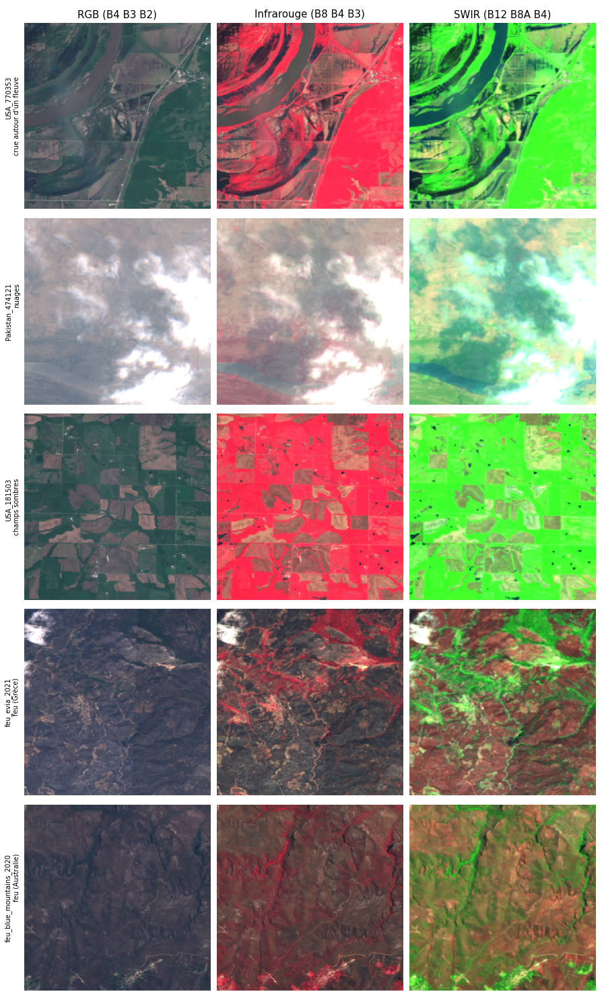
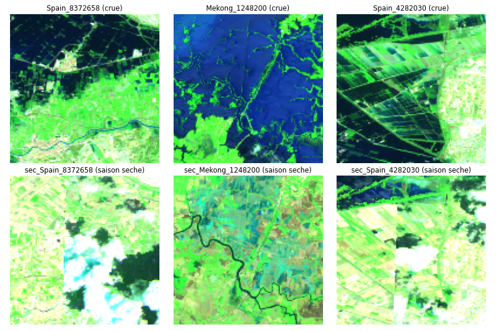

# Étape 3 : exploration de Sentinel-2 et référence simple (inondations)

Scripts : `src/explorer_s2.py`, `src/baseline_pixels.py` (données : `data/cache`, produit par `src/cache.py`).

## 1. Ce que voient les bandes de Sentinel-2

Sur 444 000 pixels annotés (Sen1Floods11, ensemble train) :

- **Dans le visible (RGB)**, l'eau de crue et la terre ont des réflectances proches. L'eau de crue, chargée de boue, est même un peu **plus claire** que la végétation dans le rouge.
- **Dans l'infrarouge (B5 à B9) et le SWIR (B11, B12)**, la terre réfléchit fortement et l'eau presque pas : c'est là que l'eau se distingue.

Capacité de chaque bande ou indice à séparer eau et terre (AUC : 0,5 = hasard, 1 = parfait ; `docs/separabilite_eau.csv`) :

| Caractéristique | AUC | Famille |
|---|---|---|
| MNDWI (B3, B11) | 0,98 | S2 hors visible |
| NDWI (B3, B8) | 0,97 | S2 hors visible |
| B11 (SWIR) seule | 0,95 | S2 hors visible |
| B8 (proche infrarouge) seule | 0,94 | S2 hors visible |
| VH (radar) | 0,89 | radar |
| VV (radar) | 0,84 | radar |
| **B4 (rouge), meilleure bande RGB** | **0,69** | **RGB** |
| Bleu − rouge | 0,68 | RGB |
| Luminosité RGB | 0,66 | RGB |

**Une bande RGB seule sépare à peine mieux l'eau de la terre que le hasard.** Toute l'information utile pour l'eau se trouve hors du visible.

Les mêmes tuiles en couleurs naturelles, en infrarouge (B8 B4 B3) et en SWIR (B12 B8A B4) : l'eau et les zones brûlées, discrètes en RGB, ressortent nettement en infrarouge et en SWIR.

## 2. Référence : un détecteur d'eau par pixel, quatre jeux de bandes

Même méthode pour chaque jeu, seule l'entrée change :

1. régression logistique par pixel (eau / pas eau), apprise sur les pixels annotés du train ;
2. part des pixels détectés comme eau dans la tuile ;
3. alerte INONDATION au-dessus d'un seuil choisi sur le train.

Évaluation sur l'**ensemble val** (Espagne, Mékong : pays jamais vus) : 50 tuiles, dont 29 inondations et 21 normales (14 Sen1Floods11 + 7 scènes Copernicus).

| Entrée | Précision | Rappel | Fausses alertes | F1 | Paramètres | ms / tuile (CPU) |
|---|---|---|---|---|---|---|
| **RGB (3 bandes)** | 0,58 | 1,00 | **100 %** | 0,73 | 4 | 7 |
| S2 complet (13 bandes) | 0,78 | 0,97 | 38 % | 0,86 | 14 | 25 |
| S1 radar (VV, VH) | 0,61 | 0,93 | 81 % | 0,74 | 3 | 8 |
| Complet (S2 + S1, 15) | 0,76 | 1,00 | 43 % | 0,87 | 16 | 26 |

Détail : `docs/resultats_baseline.csv`.

### Lecture

- **En RGB, la règle simple ne sait pas trier** : pour retrouver les inondations, elle doit alerter sur toutes les tuiles. C'est la confirmation chiffrée de la section 1.
- **Avec l'infrarouge**, les fausses alertes tombent à 38 % pour le même rappel. Elles restent beaucoup trop nombreuses : un détecteur d'eau ne sait pas faire la différence entre une crue et de l'eau normale.
- **Le radar seul** fait moins bien que l'optique, mais c'est le seul à fonctionner sous les nuages.
- Ces modèles sont minuscules (moins de 20 paramètres) et rapides : une **référence plancher**. Les modèles de l'étape 4 doivent faire nettement mieux sur les fausses alertes.

### D'où viennent les fausses alertes

Les scènes Copernicus de saison sèche (ligne du bas) sont toutes déclarées inondées par les quatre variantes. Ce ne sont pas des erreurs d'étiquette : les images sont bien sèches. Les pièges sont ceux prévus au cadrage :

- **ombres de nuages** (Espagne), sombres comme l'eau ;
- **rivière et rizières en eau** (Mékong), de l'eau réelle mais normale ;
- **bassins salants** (Espagne).

Constat supplémentaire : certaines scènes Copernicus assemblent **deux dates** (raccord vertical visible), à cause de la méthode de téléchargement (premier pixel valide dans la fenêtre). À corriger ou à signaler comme limite.

## 3. Conséquences pour la suite

1. Le RGB seul devra s'appuyer sur la **forme et le contexte** (eau étalée hors des rivières, textures), ce qu'un CNN ou YOLO peut apprendre et qu'une règle par pixel ne peut pas. C'est la vraie question de l'étape 4.
2. Distinguer **crue / eau normale** demande plus que la couleur : la forme (une rivière est fine et longue, une crue est étalée).
3. Les **ombres de nuages** et les **rizières** sont les négatifs difficiles prioritaires.
4. Les feux seront ajoutés dès que CaBuAr et les scènes de feux seront téléchargés.
